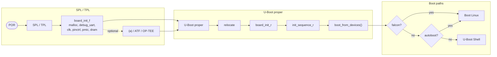

::title::

Linux Operating System architecture

::body::

---
layout: center
class: text-center
---

# OS

## Introduction

---
layout: default
---

::title::

Linux boot overview

::body::

- Bootrom executes code from a well-known location, choosing from several peripheral devices.
- Bootrom is able to strap from common devices like: NAND, eMMC, USB, SERIALS …
- Bootrom loads the first boot stage of a bootloader (U-Boot, barebox, GRUB)
- Executes the second stage to have more tools and then loads the Linux kernel.
- The Linux kernel then mounts the root filesystem and executes the first program (init in the Linux world)

---
layout: default
---

::title::

What is a bootloader

::body::

- Allows to initialize the hardware peripherals needed to boot
  - CPU
  - DDR
  - STORAGE DEVICES
- Provides software components in order to support:
  - Filesystems (fat, ext4, …)
  - Network stack and network drivers
  - …

The bootloader is the first component that allows you to boot a complete Linux solution.

---
layout: default
---

::title::

U-BOOT

::body::

U-Boot is both a first-stage and second-stage bootloader. It is loaded by the system's ROM (e.g. on-chip ROM of the ARM CPU) from a supported boot device, such as an SD card, SATA drive, NOR flash (e.g. using SPI or I²C), or NAND flash.

- First stage boot is called SPL
- Second stage boot is called U-BOOT

U-BOOT supports booting to Linux from first stage boot using Falcon mode.

---
layout: default
---

::title::

Hardware support

::body::

Architecture/SoC:

- ARM
  - 32-bit: Aspeed, Altera, Allwinner, Atmel, Broadcom, Qemu, Qualcomm, Marvell, NXP, Rockchip, STM32, Tegra, TI, UniPhier, Xilinx
  - 64-bit: Allwinner, Marvell, NXP, Rockchip, Tegra, UniPhier, Xilinx
- X86 (Baytrail, Broadwell, Quark, etc.)
- ARC, M68K, MicroBlaze, MIPS, NDS32, NIOS2, PowerPC, RISCV, Sandbox, SuperH, Xtensa

Boards: 186+ different board vendors and 1083+ different boards.

---
layout: default
---

::title::

U-BOOT booting

::body::

| Boot scheme | Boot chain |
| --- | --- |
| Bootloader | POR → BROM → Bootloader → Kernel/DTB |
| U-Boot | POR → BROM → U-Boot → Kernel/DTB |
| SoC loader | POR → BROM → SoC Loader → U-Boot → Kernel/DTB |
| SPL | POR → BROM → SPL → U-Boot proper → Kernel/DTB |
| TPL | POR → BROM → TPL → SPL → U-Boot proper → Kernel/DTB |

---
layout: default
---

::title::

U-BOOT booting sequence

::body::

---
layout: default
---

::title::

Linux kernel

::body::

---
layout: default
---

::title::

Linux Source code structures

::body::

---
layout: default
---

::title::

Linux Kernel booting notes

::body::

When the bootloader has passed on system control, the boot process is the same on all architectures. The bootloader loads both the kernel and an initial RAM-based file system (initramfs) into memory, and the kernel takes over.

After the kernel has set up memory management and detected the CPU type and its features, it initializes the hardware and mounts the temporary root file system from memory loaded with initramfs.
