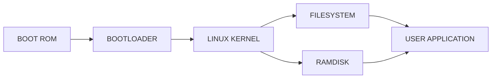

# Yocto

## Let's start

---
layout: default
---

::title::

What Yocto project try to solve?

::body::

- The industry needed a common build system and core technology
  - They collaborated to develop the BitBake tool
- The benefit of doing this is:
  - Design for the long term
  - Design for embedded
  - Transparent upstream changes
  - Vibrant developer community
- Less time spent on things which don't make money (build system, core Linux components)
- More time spent on things which do make money (app development, product development, …)

---
layout: default
---

::title::

What Yocto provide to us

::body::

- A way to package an operating system.
- A way to deploy low-level components such as bootloader and Linux kernel.
- A way to add software component dependencies to applications.
- A way to deploy applications.
- A mechanism to update our system securely.

Building an operating system means dealing with thousands of packages even on small deployments.

---
layout: default
---

::title::

Why we really need Yocto? Alternative?

::body::

- Manually deploying an operating system is a mess. We need to know exactly which library dependency chain is used, generate a toolchain, and use the knowledge of the target architecture.
- Distributions like Debian or Ubuntu are too generic and not tailor-made; we cannot easily create a minimal operating system.
- Dealing with licensing for an industrial product is quite an achievement.
- Yocto is not the only packaging system for an OS. We have other environments like Buildroot and Ubuntu Core.

---
layout: default
---

::title::

Embedded build system components

::body::

  
BOOT ROM

  
BOOTLOADER

  
LINUX KERNEL

  
RAMDISK

  
FILESYSTEM

  
USER APPLICATION

How connect them?

---
layout: default
---

::title::

Embedded build system components

::body::

Connected…

---
layout: default
---

::title::

Yocto Project overview

::body::

- The Yocto Project is an open source collaboration project that allows building custom embedded Linux-based systems.
- It was started by the Linux Foundation in 2010 and is still managed by one of its fellows: Richard Purdie.

---
layout: default
---

::title::

Yocto Project in a slide

::body::

