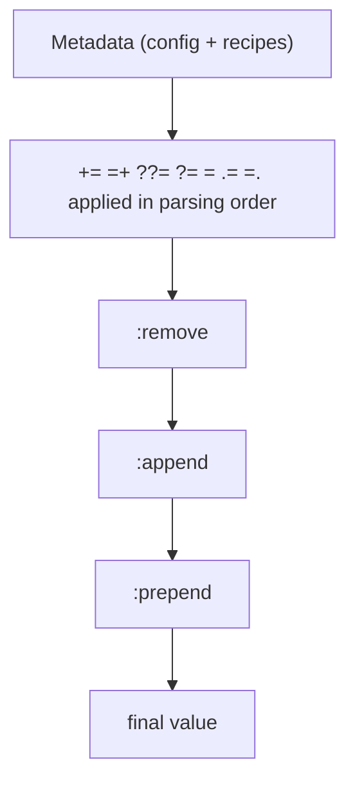

::title::

Variables

::body::

- The OpenEmbedded build system uses configuration variables to hold information.
- Variable names are in upper-case by convention, e.g. `MACHINE`
- To make configuration easier, it is possible to prepend, append or define these variables in a conditional.
- Variables defined in configuration files have a global scope (`*.conf` files).
- Variables defined in recipes have a local scope (`*.bb`, `*.bbappend`, `*.bbclass` files).
- Recipes can also access global-scope variables.
- All variables can be overridden or modified in `$BUILDDIR/conf/local.conf`.

---
layout: default
---

::title::

Variables operators

::body::

Various operators can be used to assign values to configuration variables:

| Operator | Meaning |
| --- | --- |
| `=` | expand the value when using the variable |
| `:=` | immediately expand the value |
| `+=` | append (with space) |
| `=+` | prepend (with space) |
| `.=` | append (without space) |
| `=.` | prepend (without space) |
| `?=` | assign if no other value was previously assigned |
| `??=` | same as previous, with a lower precedence |

---
layout: default
---

::title::

Operators usage example

::body::

Let's see some examples:

```text
B = "bval"
B += "additionaldata"
C = "cval"
C =+ "test"
```

The variable `B` contains `"bval additionaldata"` and `C` contains `"test cval"`.

```text
B = "bval"
B .= "additionaldata"
C = "cval"
C =. "test"
```

The variable `B` contains `"bvaladditionaldata"` and `C` contains `"testcval"`.

```text
W ??= "x"
A := "${W}" # Immediate variable expansion
W ??= "y"
B := "${W}" # Immediate variable expansion
W ??= "z"
C = "${W}"
W ?= "i"
```

With the following result: `A = "x"`, `B = "y"`, `C = "i"`, `W = "i"`.

Nice to look at section 3.1.4, Variable Expansion, in the Yocto manual.

---
layout: default
---

::title::

Operators usage example

::body::

- The operators apply their effect during parsing.
- The parsing order of files is difficult to predict; no assumption should be made about it.
- To avoid the problem, avoid using `+=`, `=+`, `.=` and `=.` in `$BUILDDIR/conf/local.conf`. Always use overrides (see the following slides).

Some real examples from a `.bb` recipe:

```text
EXTRA_OECONF += "--without-python --without-python3"
BBCLASSEXTEND = "native nativesdk"
```

---
layout: default
---

::title::

Overrides

::body::

- BitBake overrides allow appending, prepending or modifying a variable at expansion time, when the variable's value is read.
- Overrides are written as `<VARIABLE>:<override> = "some_value"`

This is used to modify the value of the variable.

---
layout: default
---

::title::

Overrides usage to modify variable value

::body::

- The append override adds at the end of the variable (without space).
  - `IMAGE_INSTALL:append = " dropbear"` adds dropbear to the packages installed on the image.
- The prepend override adds at the beginning of the variable (without space).
  - `FILESEXTRAPATHS:prepend := "${THISDIR}/${PN}:"` adds the folder to the set of paths where files are located (in a recipe).
- The remove override removes all occurrences of a value within a variable.
  - `IMAGE_INSTALL:remove = "i2c-tools"`
  - `IMAGE_INSTALL:remove:<machine> = "i2c-tools"`

It is used to change the value of the variable.

---
layout: default
---

::title::

Overrides for conditional assignment

::body::

- Append the machine name to only define a configuration variable for a given machine.
- It tries to match with values from `OVERRIDES`, which includes `MACHINE`, `SOC_FAMILY`, and more.
- If the override is in `OVERRIDES`, the assignment is applied; otherwise it is ignored.

This is used to modify the value of the variable.

---
layout: default
---

::title::

Order of variables assignment

::body::



---
layout: default
---

::title::

Packages variants

::body::

- Some packages have the same purpose, and only one can be used at a time.
- The build system uses virtual packages to reflect this. A virtual package describes functionalities, and several packages may provide it.
- Only one of the packages that provide the functionality will be compiled and integrated into the resulting image.

Let's give an example: the `virtual/bootloader` package can be implemented using U-Boot or barebox. Both packages implement the bootloader functionality.

---
layout: default
---

::title::

Packages variants

::body::

- Virtual packages are often in the form `virtual/<name>`.
- Examples of virtual packages:
  - `virtual/bootloader`: `u-boot`, `barebox`
  - `virtual/kernel`: `linux-yocto`, `linux-mainline`, `linux-freescale`
  - `virtual/libc`: `glibc`, `musl`, `newlib`

---
layout: default
---

::title::

Packages selection

::body::

How can we select the package we really want to use?

- The `PREFERRED_PROVIDER` variable helps us.
- The package names have to suffix this variable.
  - `PREFERRED_PROVIDER_virtual/kernel ?= "linux-mainline"`
  - `PREFERRED_PROVIDER_virtual/bootloader ?= "uboot-nxp"`

The provider will then select the corresponding recipes, namely:

```text
linux-mainline.bb, uboot-nxp.bb
```

---
layout: default
---

::title::

Packages version selection

::body::

Now we know that we select a specific package. How can we select the version of that package? Yocto can provide different releases. By default Yocto uses the highest release available for a given package.

- We can select a specific package version using `PREFERRED_VERSION`.
- The package names have to suffix this variable.
  - `PREFERRED_VERSION_nginx = "1.20.1"`
  - `PREFERRED_VERSION_linux-yocto = "5.14%"`

Do not be scared about `%`; this is a wildcard that matches anything after it.

---
layout: default
---

::title::

Packages

::body::

Packages are all the software components that you want to install in your board support package.

- The set of packages installed into the image is defined by the target you choose.
- It is possible to have a custom set by defining our own target, and we will later.
- When developing or debugging, adding packages can be useful, without modifying the recipes.
- Packages are controlled by the `IMAGE_INSTALL` configuration variable.

---
layout: default
---

::title::

Packages exclusion

::body::

Packages can be excluded from the build.

- The list of packages to install is also filtered using the `PACKAGE_EXCLUDE` variable.
- If you choose not to install a package using this variable and some other package is dependent on it (i.e. listed in a recipe's `RDEPENDS` variable), the OpenEmbedded build system generates a fatal installation error.
- This only works with RPM and IPK packages.

The concept of `RDEPENDS` and `DEPENDS` will be covered later in the course.

```bash
bitbake -g <image name>
oe-depends-dot -k <package> -w ./task-depends.dot
```
