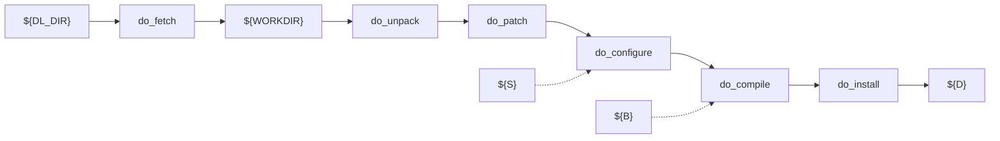

::title::

Meeting BitBake tool

::body::

As we said, BitBake is a tool able to manage metadata in order to build a Linux distribution. What type of files does BitBake manage?

- Configuration (`*.conf`)
- Classes (`*.bbclass`)
- Recipes (`*.bb` and `*.bbappend`)

Classes are a set of tasks that abstract a specific function. For example, `kernel.bbclass` abstracts tasks related to building and packaging the Linux kernel independently of version or vendor changes.

Recipes can use classes by including them in their text code.

---
layout: default
---

::title::

Meeting BitBake tool

::body::

Yocto code is organized in classes and recipes. Those are a mix of Python and Bash code. If you know Bash and Python, then you can write specific code in your classes or recipes.

What do classes and recipes do together?

- Describe the tasks that must be run
- Describe the information needed by BitBake to generate the task list and dependencies

---
layout: default
---

::title::

Meeting BitBake tool

::body::

Common BitBake tool commands:

- BitBake can be used to run a full build for a given target with `bitbake [target]`
  - target is a recipe name, possibly with modifiers, e.g.
  - `bitbake ncurses`
  - `bitbake ncurses-native`
- But it can be more precise, with optional options:
  - `-c <task>` execute the given task
  - `-s` list all locally available recipes and their versions. If you want to match a given package: `| grep -e "^<packagename>"`
  - `-f` force the given task to be run by removing its stamp file
  - `-b <recipe>` execute tasks from the given recipe (without resolving dependencies)

---
layout: default
---

::title::

Meeting BitBake tool

::body::

BitBake examples:

- `bitbake -c listtasks virtual/kernel`
  - Gives a list of the available tasks for the recipe providing the package `virtual/kernel`. Tasks are prefixed with `do_`.
- `bitbake -c menuconfig virtual/kernel`
  - Execute the task `menuconfig` on the recipe providing the `virtual/kernel` package.
- `bitbake -f dropbear`
  - Force the `dropbear` recipe to run all tasks.
- `bitbake --runall=fetch core-image-minimal`
  - Download all the package sources without building.
- `bitbake --help`
  - Full description of available commands.

---
layout: default
---

::title::

Meeting BitBake tool

::body::

Let's talk a bit about dependencies. There are three different types of dependencies:

- Build time
- Execution time
- Tasks

The concept of dependency is well known: a dependency represents a specific feature requiring another package to be available. This dependency can be needed at build time or at execution time. For instance, `iperf3` needs a shell instance, or boost needs a toolchain that supports `std++`.

---
layout: default
---

::title::

Meeting BitBake tool

::body::

What about tasks?

Tasks define the rules needed to download, compile, install, etc. a single package and how those should be ordered. You cannot install before compiling, and you cannot compile before running a task that installs or builds the dependencies needed to compile a package. Those are obvious concepts!

---
layout: default
---

::title::

Meeting BitBake tool

::body::

Let's see the default tasks:

- `do_fetch`
- `do_unpack`
- `do_patch`
- `do_configure`
- `do_compile`
- `do_install`
- `do_package`
- `do_rootfs`

You can get a list of existing tasks for a recipe with:

```bash
bitbake <recipe> -c listtasks
```

---
layout: default
---

::title::

Meeting BitBake tool

::body::

Let's see how tasks cooperate together:



---
layout: default
---

::title::

Meeting BitBake tool

::body::

| Command | Description |
| --- | --- |
| `bitbake <package> -c devshell` | Open a new shell with the necessary system values already defined for the package |
| `bitbake <package> -c listtasks` | List all tasks for the package |
| `bitbake virtual/kernel -c menuconfig` | Interactive kernel configuration |
| `bitbake --runall=fetch <image>` | Fetch sources for a particular image |
| `bitbake-layers show-layers` | Show layers |
| `bitbake-layers show-recipes "*-image-*"` | Show possible images to bake. Without `"*-images-*"`, it shows ALL recipes |
| `bitbake -v <yocto image> 2>&1 \| tee image_build.log` | Print (on console) and store verbose baking |

---
layout: default
---

::title::

Meeting BitBake tool vs Buildroot

::body::

| Buildroot | BitBake |
| --- | --- |
| `make all` | `bitbake <yocto image>` |
| `make busybox` | `bitbake busybox` |
| `make busybox-configure` | `bitbake -c configure busybox` |
| `make busybox-reconfigure` | `bitbake -C configure busybox` |
| `make clean` | `bitbake -c clean world` |
| `make busybox-dirclean` | `bitbake -c clean busybox` |
| `BR2_JLEVEL=2 make` | `PARALLEL_MAKE="-j 2" bitbake …` |
| — | `BB_NUMBER_THREADS=2 bitbake …` |
| — | `SSTATE_DIR ?= "/.sstate-cache"` |

---
layout: default
---

::title::

Playing with Yocto configuration

::body::

- Modify build configuration
- Customize the package selection
- Play with BitBake
